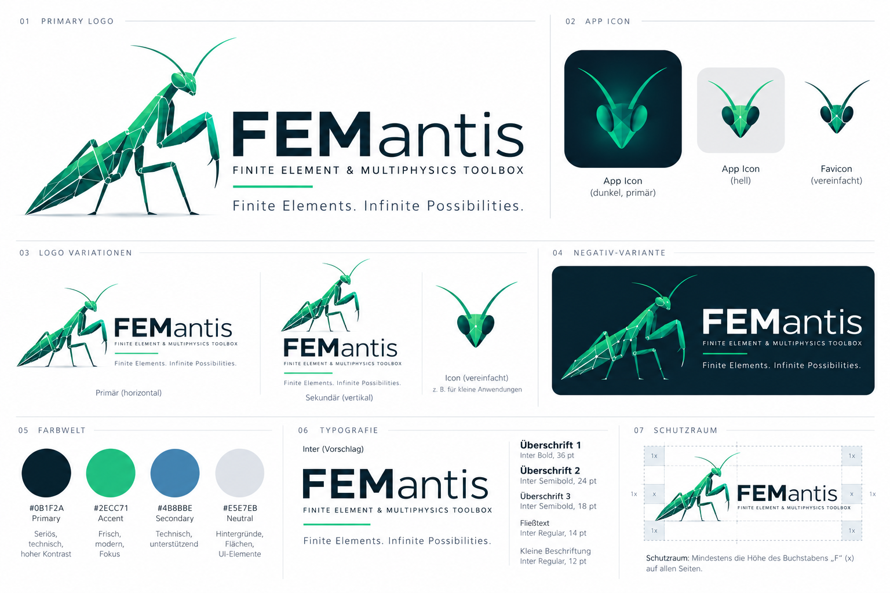

# Femantis — Bildinventar

[Corporate Identity](../75_FEMANTIS_CORPORATE_IDENTITY.md) ·
[Umbenennungsplan](../76_FEMANTIS_RENAMING_PLAN.md)

## Vorhandene Bilddatei

| Merkmal | Wert |
|---|---|
| Datei | [femantis-brand-board-reference.png](assets/femantis-brand-board-reference.png) |
| Ursprünglicher Dateiname | ChatGPT-Bild 5. Okt. 2026, 17_29_43.png |
| Herkunft | Vom Auftraggeber als visuelle Referenz am 05.10.2026 beigefügt |
| Typ | Raster-Bildtafel; Logo-/Iconillustrationen, keine Fotografie |
| Bearbeitung | Keine; bitidentische Kopie, ausschließlich Dateiname normalisiert |
| Urheber / eigenständige Lizenz | Nicht angegeben; keine zusätzliche freie Bildlizenz behauptet |
| Publikationsumfang | Archivierung im GitHub-Repository gemäß Auftrag |
| Produktionsstatus | Referenz; keine freigestellten Logo-Master oder eigenständigen Icondateien |
| SHA-256 | `dff9ee02f5f75db4f03e194a3d0297c9915bf79c64d145ffc4dc78c526e89d2f` |

Die Bildtafel zeigt Primärlogo, App-Icons dunkel/hell, vereinfachtes Favicon,
horizontale/vertikale Varianten, Negativlogo, Farbwelt, Typografie und Schutzraum.
Sie wird bewusst vollständig gezeigt, damit der Bezug zwischen den Varianten
erhalten bleibt. Separate Fotos wurden nicht geliefert. Das Aufnahmebriefing
im Leitfaden definiert spätere Motive; deren Dateien werden erst nach Erstellung
und Rechteklärung hier ergänzt.

## Farbkontrast-Nachweis

Berechnung aus den im Leitfaden angegebenen sRGB-Werten: pro Kanal c zwischen
0 und 1, c/12.92 bei c ≤ 0.04045, sonst ((c+0.055)/1.055)^2.4.
Relative Luminanz L = 0.2126 R + 0.7152 G + 0.0722 B;
Kontrast = (Lhell+0.05)/(Ldunkel+0.05). Auf zwei Stellen gerundet.

| Paar | Kontrast |
|---|---|
| petrol / white | 16.89:1 |
| petrol / neutral | 13.64:1 |
| petrol / green | 8.03:1 |
| white / green | 2.10:1 |
| blue / white | 3.66:1 |
| white / blue | 3.66:1 |

Grundlage: [W3C Contrast Minimum](https://www.w3.org/WAI/WCAG22/Understanding/contrast-minimum.html).
Logos sind keine normalen Textflächen; der Leitfaden verlangt trotzdem gute
Erkennbarkeit. Eine vollständige UI-Zugänglichkeitsprüfung ist separat nötig.

## Pflegeformat für weitere Assets

Für jedes neue Bild: Datei/Variante, Format/Abmessungen, Quelle/Urheber,
Lizenz/Freigabe, Datum, Motiv, Bearbeitung, Alt-Text, SHA-256 und Freigabestatus.
SVG-/PDF-Master und einzelne App-Icons/Favicons stehen im Produktionsbacklog
des Leitfadens. Keine Dateiverweise anlegen, bevor die Datei tatsächlich existiert.
